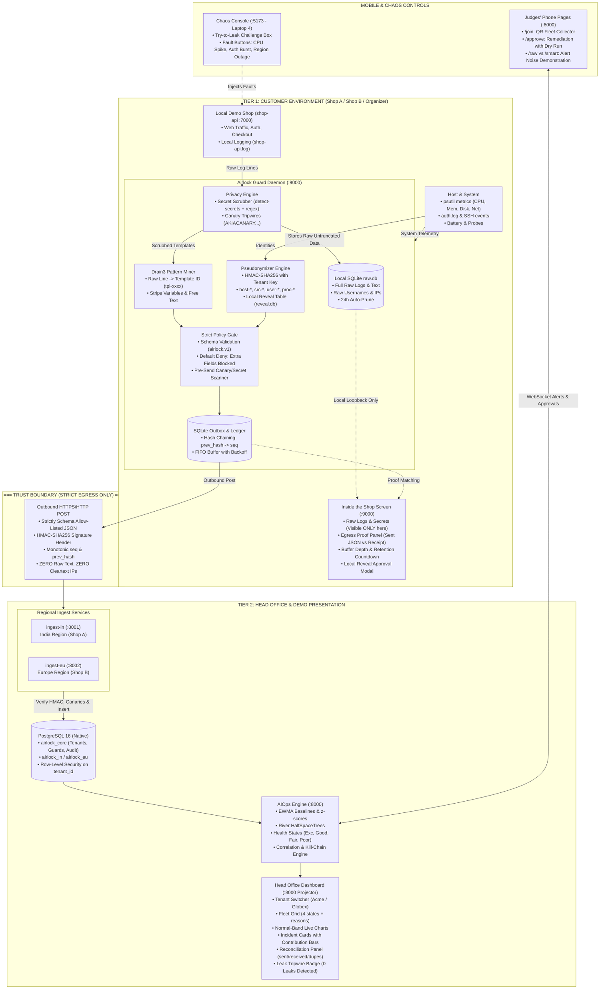

# Airlock: Round 1 Data-Flow Sketch & Trust Boundary
**CICADA 2026 – Smart Observability Hackathon · Judging Round 1 (10 Marks)**
*Presenter: Anisa Islam (F · Frontend and Demo)*

---

## 1. Executive Summary & Core Pitch
> *"Other observability tools ask you to trust that they don't leak. Airlock proves it, live."*
> *"We bring the AI to the data, never the data to the AI."*

In traditional observability, raw logs, database queries, and system traces leave customer networks and are shipped to multi-tenant cloud vendors—creating severe privacy liabilities, credential leak risks, and compliance breaches.

**Airlock solves this with a strict physical trust boundary:**
- Telemetry analysis, secret scrubbing, pattern mining, and raw storage remain strictly **inside** the customer boundary.
- **Zero raw text crosses the perimeter:** Outbound communication allows only strongly typed, allow-listed numerical aggregates, fixed categorization enums, and cryptographic pseudonyms.
- **Cryptographic Egress Proof:** Every outbound transmission is hash-chained in an immutable local ledger and reconciled with signed receipts from head office.

---

## 2. Architecture & Data-Flow Diagram

---

## 3. Data Visibility Matrix: Who Sees What?

| Information Category | Inside the Shop Screen (`:9000`) | Head Office Dashboard (`:8000`) | Chaos Console (`:5173`) | Phone Pages |
|---|---|---|---|---|
| **Raw Log Messages** | ✅ **Full raw text** visible for local debugging | ❌ **Completely Absent** (Never sent) | ❌ Absent | ❌ Absent |
| **Passwords & API Keys** | ✅ Visible in local logs (for verification) | ❌ **0% Exposure** (Redacted + Tripwire blocked) | ⚠️ Injection test input only | ❌ Absent |
| **User Identifiers** | ✅ Real usernames (`admin`, `alice`) | 🔒 Pseudonyms only (`user-7f3a8b1c`) | ❌ Absent | 🔒 Pseudonyms |
| **Host & IP Addresses** | ✅ Real IPs (`192.168.1.50`) | 🔒 Pseudonyms only (`host-9c2e01fa`, `src-4a12be88`) | ❌ Target hostname | 🔒 Pseudonyms |
| **Log Patterns** | ✅ Template text + raw message | 📊 Drain3 Pattern ID (`tpl-3fa1`) & count only | ❌ Absent | ❌ Absent |
| **Metrics & Health** | ✅ Local buffer depth & system metrics | 📊 Aggregated 2s avg/max + Normal Bands | ❌ Absent | 📊 Health State |
| **Incident Explanations**| ❌ Local operator focuses on raw logs | 🧠 Full Incident cards, contribution %, counterfactual | ❌ Absent | 📱 Clean summary (`/smart`) |
| **Egress Proof & Ledger**| ✅ **Exact JSON sent, SHA-256, ✅ receipt** | 📊 Reconciliation table (sent vs received vs gaps) | ❌ Absent | ❌ Absent |
| **Remediation Actions** | 🔒 Local approval prompt for pseudonym reveals | ⚡ Propose remediation & review audit log | ❌ Absent | 📱 **Dry-run & Approve button** |

---

## 4. The 4 Mandatory Demo Moments (Scored in Judging)

### 1. The "Try-to-Leak" Challenge (Proof of Privacy)
- **Judge Action:** The judge enters an arbitrary secret or password into the Chaos Console's Try-to-Leak box (e.g., `AWS_SECRET_KEY=wJalrXUtnFEMI/K7MDENG/bPxRfiCYEXAMPLEKEY`).
- **Shop Screen:** Shows the raw log line in `raw.db` containing the key.
- **Head Office Screen:** Shows only `secret_redacted: 1` count and pattern template ID `tpl-0042`. The raw secret **never** crosses the trust boundary.
- **Leak Badge:** Egress audit confirms 0 leak occurrences.

### 2. Egress Proof Panel (Mathematical Proof)
- **What Judge Sees:** On the Shop Screen, the judge inspects the Egress Proof panel showing the exact JSON payload, its SHA-256 hash, and the cryptographically signed receipt returned by the regional ingest service.
- **Why It Matters:** Eliminates the "black-box trust" assumption. The judge can personally verify that what left the shop matches what head office received bit-for-bit.

### 3. Outage Buffer & Reconciliation (Resilience)
- **Judge Action:** Judge triggers "Pause Region Ingest" or network cable disconnect.
- **Shop Behavior:** Guard detects unreachable endpoint, holds telemetry in SQLite outbox, and applies exponential backoff (1s, 2s, 4s, 8s, 10s).
- **Head Office:** Health state marks node as `Stale` at 10s and `Poor` at 30s.
- **Resume:** Upon reconnection, outbox drains in strict FIFO sequence. Reconciliation panel proves:
  $$\text{Sent} = \text{Received}, \quad \text{Duplicates} = 0, \quad \text{Gaps} = 0$$

### 4. Noisy vs. Clean Phones (AIOps Noise Cut)
- **Demonstration:** Two phones placed side by side.
  - **Phone 1 (`/raw`):** Buzzes incessantly for every low-level alert (47 raw alerts).
  - **Phone 2 (`/smart`):** Receives **one** unified, prioritized incident ("Possible compromise: cryptomining" with 94% noise cut, root cause, and 1-tap safe rollback remediation).
